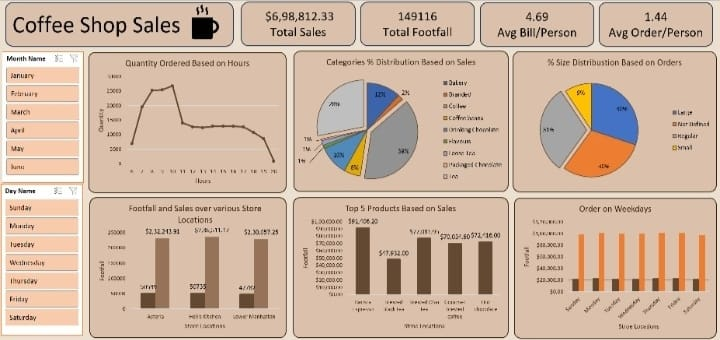

# ☕ Coffee Shop Sales Dashboard (Excel Project)

An interactive Excel dashboard built to analyze and visualize comprehensive coffee shop sales data, tracking key performance indicators (KPIs), store locations, and product performance.

---

## 📊 Dashboard Preview

---

## 🚀 Key Performance Indicators (KPIs)
- **Total Sales:** $6,98,812.33[cite: 1]
- **Total Footfall:** 149,116[cite: 1]
- **Avg Bill/Person:** $4.69[cite: 1]
- **Avg Order/Person:** 1.44[cite: 1]

---

## 📈 Key Insights & Features
1. **Quantity Ordered Based on Hours:** Visualizes peak business hours throughout the day.[cite: 1]
2. **Categories % Distribution Based on Sales:** Breakdown of top-selling product categories (Bakery, Coffee, Drinking Chocolate, etc.).[cite: 1]
3. **% Size Distribution Based on Orders:** Analyzes customer preference for sizes (Large, Regular, Small, etc.).[cite: 1]
4. **Footfall & Sales Across Store Locations:** Compares performance across various branches (Astoria, Hell's Kitchen, Lower Manhattan).[cite: 1]
5. **Top 5 Products Based on Sales:** Highlights the best-performing items.[cite: 1]
6. **Order on Weekdays:** Day-by-day analysis of sales and footfall patterns.[cite: 1]
7. **Interactive Slicers:** Includes Month and Day Name slicers for dynamic filtering.[cite: 1]

---

## 🛠️ Tools & Technologies Used
- **Microsoft Excel:** Pivot Tables, Pivot Charts, Slicers, Data Cleansing, and Dashboard Design.

---

## 📂 Files Included
- `Coffee_Shop_Sales_Dashboard.xlsx` - The complete Excel workbook containing raw data, pivot tables, and the interactive dashboard.

---